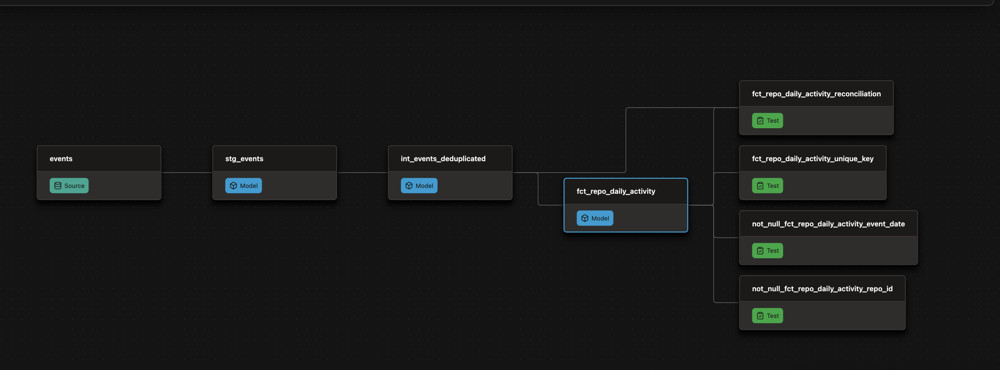

# ⚡ GH Archive Analytics Platform — dbt 2.0 (Fusion) + DuckDB

[-orange.svg)](https://docs.getdbt.com)
[](https://duckdb.org)
[](https://github.com/astral-sh/uv)
[](docs/index.html)

An end-to-end, high-throughput analytical platform processing **16.1M+ GitHub events** on local hardware with zero cloud cost, using Python, DuckDB, and dbt 2.0.

> 📖 **Interactive Documentation & Lineage DAG:** [View dbt documentation](docs/index.html) *(or via GitHub Pages)*

---

## 🎯 Executive Summary & Key Metrics

| Metric | Result | Engineering Impact |
|---|---|---|
| **Volume Processed** | **16,142,655 rows** | 3 full days of global GitHub events (2024-01-15 to 2024-01-17) |
| **Pipeline Runtime** | **~48 seconds** | Full incremental rebuild & 22 data tests executed |
| **Optimization Gain** | **110x speedup** | Reduced step execution from **1,793s to 16s** by eliminating payload bottlenecks |
| **Storage Footprint** | **75x reduction** | Intermediate/mart storage cut down from **17 GB to 234 MB** |
| **Data Quality** | **22 automated tests** | Zero duplicate events, partition integrity verified, reconciliation tested |
| **Infrastructure Cost** | **$0.00** | Engineered entirely in-process using DuckDB and `uv` |

---

## 🏗️ Architecture & Data Lineage

The data pipeline adopts a Medallion Architecture pattern:

```text
GitHub Archive (.json.gz)
         │
         ▼ (Idempotent Python Ingestion)
[ Bronze: Hive-partitioned Parquet (date=YYYY-MM-DD / hour=HH.parquet) ]
         │
         ▼ (dbt: Ephemeral staging)
[ Staging: stg_events ] (Flattens JSON actor/repo/org metadata)
         │
         ▼ (dbt: Incremental with literal partition pruning)
[ Intermediate: int_events_deduplicated ] (Deduplication via window functions)
         │
         ├───────────────────────────────┬───────────────────────────────┐
         ▼                               ▼                               ▼
[ Mart: dim_repo ]              [ Mart: dim_actor ]             [ Mart: Daily Facts ]
(Lifetime repository stats)      (Lifetime user stats)           ├─ fct_repo_daily_activity
                                                                 └─ fct_event_type_daily
```



---

## 🧭 What I Built / How I Implemented / Where to Look

| Component | Engineering Implementation | Source Files |
|---|---|---|
| **Ingestion Engine** | Idempotent hourly downloader, atomic `.tmp` staging, Parquet ZSTD conversion | [`src/ingestion/download.py`](src/ingestion/download.py) |
| **Bronze Storage** | Hive-partitioned directory layout (`date=.../hour=...`) | [`data/bronze/events/`](data/bronze/events/) |
| **Staging Model** | Ephemeral SQL model projecting typed IDs and flattened JSON paths | [`models/staging/stg_events.sql`](analytics/models/staging/stg_events.sql) |
| **Incremental Core** | Deduplication via `QUALIFY ROW_NUMBER()`, compile-time partition pruning | [`models/intermediate/int_events_deduplicated.sql`](analytics/models/intermediate/int_events_deduplicated.sql) |
| **Analytical Marts** | Daily repository activity facts, event-type aggregates, and dimension tables | [`models/marts/`](analytics/models/marts/) |
| **Data Quality Suite** | Custom singular tests (arithmetic reconciliation, composite key uniqueness, partition skew) | [`tests/`](analytics/tests/) |
| **Orchestration / Engine** | Standalone dbt 2.0 (Fusion engine) paired with DuckDB | [`analytics/dbt_project.yml`](analytics/dbt_project.yml) |

---

## 🔬 Engineering Challenges & Performance Deep Dives

### 1. The JSON Payload Bottleneck (110x speedup & 75x storage cut)
- **The Issue:** Initially, passing the wide, unstructured `payload` column into downstream models caused DuckDB to spill **17+ GB of temporary files** to disk during the `QUALIFY ROW_NUMBER() OVER (...)` sorting phase. The first incremental load took **1,793s (30 mins)**.
- **The Fix:** Removed the heavy raw `payload` from the general fact workflow and converted staging into an `ephemeral` model. Transformations focus solely on typed surrogate keys and flattened metadata.
- **Result:** Execution dropped to **15.9s (~110x faster)**, and disk usage fell from **17 GB to 234 MB (~75x smaller)**.

### 2. Subquery vs. Compile-time Literal Partition Pruning
- **The Issue:** Filtering partitions using dynamic subqueries like `WHERE date >= (SELECT MAX(event_date) FROM {{ this }})` prevented DuckDB from pruning Hive partitions at compile time. DuckDB generated a `Nested Loop Join`, scanning all 72 parquet files instead of the targeted 24.
- **The Fix:** Computed the watermark using Jinja (`run_query`) before building the SQL AST:
  ```sql
  
    
  
  WHERE partition_date >= CAST('{{ max_date }}' AS DATE)
  ```
- **Result:** Query plans confirmed selective scans: `Scanning Files: 24/72`, eliminating redundant I/O.

### 3. Build & Test dbt Models
```bash
cd analytics
dbt build --profiles-dir .
```

### 4. Serve Documentation Locally
```bash
dbt docs generate --profiles-dir . --write-catalog
dbt docs serve --profiles-dir .
```
Browse the full documentation and interactive DAG at `http://127.0.0.1:8000`.

---

## 📁 Repository Layout

```text
Gh_Archive_Analytics/
├── analytics/
│   ├── dbt_project.yml          # dbt configuration
│   ├── profiles.yml             # DuckDB target & memory configuration
│   ├── models/
│   │   ├── staging/             # Ephemeral raw JSON extraction
│   │   ├── intermediate/        # Incremental deduplication core
│   │   └── marts/               # Dimensional tables & Daily activity facts
│   └── tests/                   # Custom singular tests (reconciliation & keys)
├── data/                        # Ignored by Git (Bronze Parquet + DuckDB warehouse)
├── docs/                        # Static dbt docs & Lineage assets for GitHub Pages
├── src/
│   └── ingestion/               # Hourly archive downloader & Parquet converter
├── pyproject.toml               # Python dependencies managed by uv
└── README.md
```

---

## 👨‍💻 Author
**Chouaib MOUID**
***Data Engineer***

📫 Contact & Liens
- LinkedIn : [MOUID / Chouaib](https://www.linkedin.com/in/chouaib-mouid-200893438/)
- GitHub : [Chouaib-mouid](https://github.com/chouaibmouidis-py)